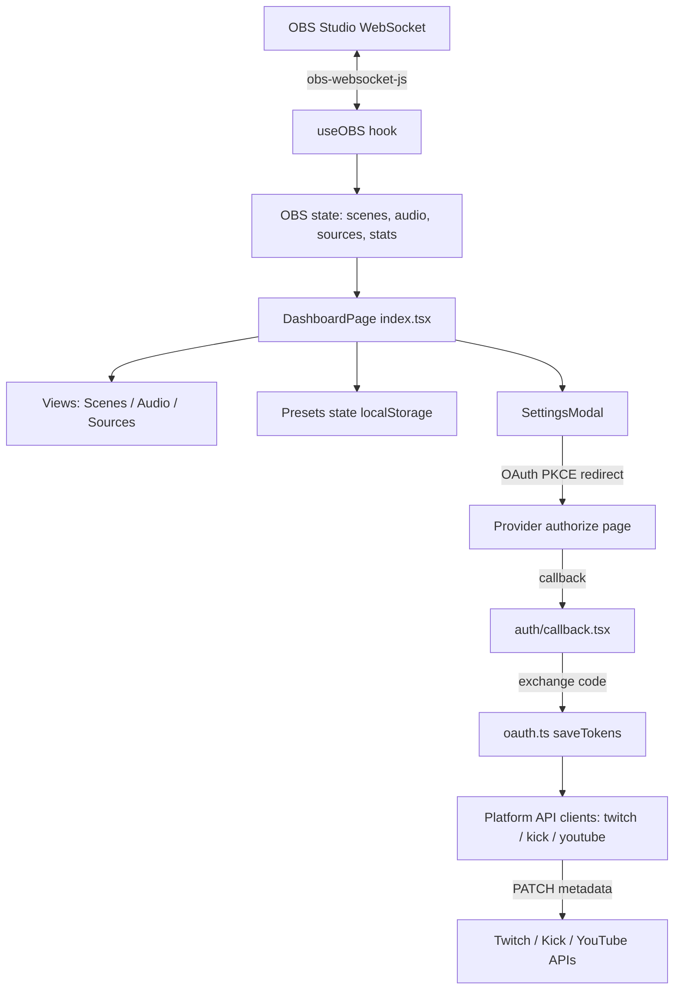

# Stream Control Deck — Developer Guide

A comprehensive guide for developers working on **Stream Control Deck** (a.k.a. "Stream Deck OS"), a web-based control dashboard for live streamers. It lets you control OBS Studio in real time and push stream metadata (title + category) to Twitch, Kick, and YouTube from a single interface.

---

## Table of Contents

1. [Project Overview](#1-project-overview)
2. [Tech Stack](#2-tech-stack)
3. [Getting Started](#3-getting-started)
4. [Project Structure](#4-project-structure)
5. [Architecture & Data Flow](#5-architecture--data-flow)
6. [Core Modules](#6-core-modules)
   - [OBS Integration (`useOBS`)](#61-obs-integration-useobs)
   - [OAuth & Token Management](#62-oauth--token-management)
   - [Platform API Clients](#63-platform-api-clients)
   - [Presets System](#64-presets-system)
   - [UI Layer](#65-ui-layer)
7. [Environment Variables](#7-environment-variables)
8. [Local Storage Keys](#8-local-storage-keys)
9. [Routing](#9-routing)
10. [Styling & Theming](#10-styling--theming)
11. [Scripts & Tooling](#11-scripts--tooling)
12. [Common Development Tasks](#12-common-development-tasks)
13. [Security Considerations](#13-security-considerations)
14. [Troubleshooting](#14-troubleshooting)

---

## 1. Project Overview

**Stream Control Deck** is a single-page dashboard that acts as a "deck" for streamers. It provides:

- **OBS Studio control** — connect over the OBS WebSocket protocol to switch scenes, toggle source visibility, control audio (mute/volume), monitor live VU meters, and view real-time telemetry (FPS, CPU, RAM, bitrate, dropped frames).
- **Stream presets** — save a bundle of metadata (title, game category, OBS scene, per-platform category IDs) and apply it with one click. Applying a preset switches the OBS scene and syncs metadata to all connected platforms.
- **Multi-platform OAuth** — connect Twitch, Kick, and YouTube accounts via OAuth 2.0 with PKCE, then push live title/category updates to each platform's API.

The app is **client-side only** (no backend server). All state, tokens, and presets are stored in the browser (`localStorage` / `sessionStorage`).

---

## 2. Tech Stack

| Layer | Technology |
|-------|-----------|
| Framework | [TanStack Start](https://tanstack.com/start) (React 19) |
| Build tool | Vite 8 |
| Language | TypeScript 6 (strict mode) |
| Routing | TanStack Router (file-based) |
| UI components | shadcn/ui (Base UI style) |
| Styling | Tailwind CSS v4 + `tw-animate-css` |
| Icons | `lucide-react` |
| OBS control | `obs-websocket-js` v5 |
| Validation | `zod` v4 |
| Testing | Vitest + Testing Library + jsdom |
| Linting | ESLint 9 (`@tanstack/eslint-config`) |
| Formatting | Prettier + `prettier-plugin-tailwindcss` |
| Package manager | pnpm (workspace) |

---

## 3. Getting Started

### Prerequisites

- **Node.js** (recent LTS)
- **pnpm** (the repo uses a pnpm workspace)
- **OBS Studio** with the **WebSocket server** enabled (Tools → WebSocket Server Settings). Default port is `4455`.

### Install & run

```bash
# 1. Install dependencies
pnpm install

# 2. Start the dev server (port 3000)
pnpm dev

# 3. Open the app
#    http://localhost:3000
```

### Verify it works

1. Open OBS Studio and enable the WebSocket server (note the port and password).
2. Open the app, press **⌘K** (or Ctrl+K) to open Settings.
3. In the **OBS** tab, enter your host/port/password and save.
4. The status bar should show **"OBS Connected"** and the Scenes/Audio/Sources tabs become live.

---

## 4. Project Structure

```
stream-control-deck/
├── components.json            # shadcn/ui config
├── eslint.config.js           # ESLint 9 flat config
├── package.json
├── pnpm-workspace.yaml
├── tsconfig.json              # strict TS, @/* path alias
├── vite.config.ts             # Vite + TanStack Start + Tailwind plugins
├── public/
│   ├── manifest.json
│   └── robots.txt
└── src/
    ├── router.tsx             # TanStack Router factory
    ├── routeTree.gen.ts       # Auto-generated route tree (do not edit)
    ├── styles.css             # Tailwind v4 + design tokens (CSS variables)
    ├── vite-env.d.ts
    ├── components/
    │   ├── ActiveHeroCard.tsx     # Active broadcast hero card
    │   ├── Header.tsx             # Top bar (Go Live, settings, RTL toggle)
    │   ├── MetricsWidget.tsx      # CPU/RAM/bitrate/FPS widget
    │   ├── PresetModal.tsx        # Create/edit preset dialog
    │   ├── SettingsModal.tsx      # OBS + platform OAuth settings
    │   ├── Sidebar.tsx            # Left nav + emergency End Stream
    │   ├── StatusBar.tsx          # Bottom telemetry bar
    │   ├── StreamPresetCard.tsx   # Preset card with apply/edit/delete
    │   ├── theme-provider.tsx     # Dark/light/system theme context
    │   ├── mode-toggle.tsx
    │   ├── ui/                    # shadcn/ui primitives
    │   └── views/
    │       ├── AudioView.tsx      # Audio mixer + VU meters
    │       ├── ScenesView.tsx    # Scene selector grid
    │       └── SourcesView.tsx   # Source visibility toggles
    ├── hooks/
    │   ├── use-mobile.ts
    │   └── useOBS.ts             # Core OBS WebSocket hook
    ├── lib/
    │   ├── kick-auth.ts          # Kick OAuth flow
    │   ├── kick.ts               # Kick API client
    │   ├── oauth-pkce.ts         # PKCE verifier/challenge generation
    │   ├── oauth.ts              # Shared OAuth + token persistence
    │   ├── twitch-auth.ts        # Twitch OAuth flow
    │   ├── twitch.ts             # Twitch Helix API client
    │   ├── utils.ts              # cn() class merge helper
    │   ├── youtube-auth.ts       # YouTube OAuth flow + API client
    │   └── youtube-categories.ts # Static YouTube category list
    ├── routes/
    │   ├── __root.tsx            # Root layout (providers, shell)
    │   ├── index.tsx             # Dashboard page (main app)
    │   └── auth/
    │       └── callback.tsx      # OAuth redirect handler
    └── types/
        └── preset.ts             # StreamPreset zod schema + types
```

---

## 5. Architecture & Data Flow

The app is a **single-page dashboard** with a tabbed layout. The main page (`src/routes/index.tsx`) owns nearly all state and wires everything together.



### Key data flow

1. **OBS connection** — `useOBS()` opens a WebSocket to OBS on mount, subscribes to events, and polls telemetry every 2 seconds.
2. **User actions** (scene switch, mute, toggle source, start/stop stream) call methods on the `useOBS` hook, which issue OBS WebSocket requests and update local React state.
3. **Preset apply** — `handleApplyPreset` in `index.tsx`:
   1. Marks the preset active in state.
   2. Switches the OBS scene (if connected and a scene is mapped).
   3. Calls `handleSyncTwitch`, `handleSyncKick`, `handleSyncYouTube` to push metadata.
4. **OAuth** — Settings modal starts a PKCE flow, redirects to the provider, and the `/auth/callback` route exchanges the code for tokens, which are persisted to `localStorage`.

---

## 6. Core Modules

### 6.1 OBS Integration (`useOBS`)

**File:** `src/hooks/useOBS.ts`

This is the heart of OBS control. It wraps `obs-websocket-js` v5 and exposes a single hook with all OBS state and actions.

**Exposed state:**

| State | Type | Description |
|-------|------|-------------|
| `isConnected` | `boolean` | WebSocket connection status |
| `isStreaming` | `boolean` | Whether the OBS output is active |
| `currentScene` | `string` | Active program scene name |
| `scenes` | `string[]` | All scene names |
| `audioInputs` | `OBSAudioInput[]` | Audio inputs with mute/volume/peak |
| `sceneItems` | `OBSSceneItem[]` | Sources in the current scene |
| `stats` | `OBSStats` | FPS, CPU, RAM, bitrate, dropped frames |

**Exposed actions:**

| Method | OBS request | Purpose |
|--------|-------------|---------|
| `connect()` | — | Open WebSocket (reads host/port/password from localStorage) |
| `switchScene(name)` | `SetCurrentProgramScene` | Switch active scene |
| `toggleMute(inputName)` | `ToggleInputMute` | Toggle an input's mute |
| `setVolumeDb(inputName, db)` | `SetInputVolume` | Set input volume in dB |
| `toggleItemVisibility(id, enabled)` | `SetSceneItemEnabled` | Show/hide a source |
| `startStream()` | `StartStream` | Start OBS output |
| `stopStream()` | `StopStream` | Stop OBS output |

**Subscribed OBS events:**

- `CurrentProgramSceneChanged` — update current scene + refresh scene items
- `InputMuteStateChanged` — update mute state
- `InputVolumeChanged` — update volume
- `SceneItemEnableStateChanged` — update source visibility
- `StreamStateChanged` — update streaming status
- `InputVolumeMeters` — high-frequency VU meter data (converted from linear multiplier to a 0–100% dB scale)

**Telemetry polling:** Every 2 seconds, `pollTelemetry` calls `GetStats` and `GetStreamStatus`, and computes a live bitrate from the byte delta between polls.

> **Note:** The connection uses `EventSubscription.All | EventSubscription.InputVolumeMeters` to receive the high-frequency volume meter events.

### 6.2 OAuth & Token Management

**Files:** `src/lib/oauth.ts`, `src/lib/oauth-pkce.ts`, `src/lib/{twitch,kick,youtube}-auth.ts`

The OAuth system is shared across all three platforms via a generic core in `oauth.ts`.

**`oauth.ts` responsibilities:**

- **`beginAuthorization()`** — generates a PKCE verifier/challenge + CSRF state, persists an OAuth session to `sessionStorage`, and builds the provider's authorize URL.
- **`exchangeCode()`** — exchanges the authorization code for tokens using the stored verifier, computes `expiresAt`, persists tokens, and clears the session.
- **`saveTokens()` / `loadTokens()` / `clearTokens()`** — per-platform token persistence in `localStorage` under keys like `oauth_twitch_access_token`.
- **`refreshTokens()`** — refreshes an expired access token using the stored refresh token.
- **`isTokenExpired()`** — checks `expiresAt` against `Date.now()`.
- **`getRedirectUri()`** — returns `${window.location.origin}/auth/callback`.

**Per-platform auth modules** (`twitch-auth.ts`, `kick-auth.ts`, `youtube-auth.ts`) define the provider's authorize/token URLs, scopes, and convenience wrappers (`startXxxOAuth`, `exchangeXxxCode`, `refreshXxxToken`, `getXxxAccessToken`).

**PKCE generation** (`oauth-pkce.ts`) uses `window.crypto` to create a 32-byte verifier, SHA-256 challenge (base64url), and a 16-byte CSRF state.

**The callback route** (`src/routes/auth/callback.tsx`):
1. Reads `code` and `state` from the URL.
2. Reads the stored OAuth session and **validates the state** (CSRF protection).
3. Calls the correct `exchangeXxxCode` based on the stored provider.
4. Shows success/error UI and redirects back to `/`.

### 6.3 Platform API Clients

**Files:** `src/lib/twitch.ts`, `src/lib/kick.ts`, `src/lib/youtube-auth.ts`

Each client follows the same pattern: get a valid token (refreshing if needed), resolve a category ID from a name if not provided, then PATCH the live metadata.

| Platform | Endpoint | Category resolution |
|-----------|----------|---------------------|
| **Twitch** | `PATCH /helix/channels?broadcaster_id=...` | `GET /helix/games?name=...` |
| **Kick** | `PATCH /public/v1/channels/{id}` | `GET /public/v1/categories?name=...` |
| **YouTube** | `PUT /youtube/v3/liveBroadcasts` | `GET /youtube/v3/videoCategories` |

**Key functions:**

- `updateTwitchChannelInfo({title, gameId, categoryName})` — verifies the user, resolves the game ID, patches the channel.
- `updateKickChannelInfo({title, categoryId, categoryName})` — resolves category, fetches the channel, patches it.
- `updateYouTubeBroadcast({title, categoryId, categoryName})` — **requires an active live broadcast**; finds it via `getCurrentLiveBroadcast`, then PUTs the updated snippet.

**YouTube categories** (`youtube-categories.ts`) is a static list of common category names → numeric IDs (e.g., Gaming → `20`).

### 6.4 Presets System

**File:** `src/types/preset.ts`, `src/components/PresetModal.tsx`, `src/components/StreamPresetCard.tsx`

**Schema** (`StreamPresetSchema`, zod):

```ts
{
  id: string
  name: string            // required
  title: string           // required
  gameCategory: string    // required
  twitchGameId?: string
  kickCategory?: string
  kickCategoryId?: string
  youtubeCategory?: string
  youtubeCategoryId?: string
  obsSceneName?: string
  isActive: boolean
}
```

**Persistence:** Presets are stored in `localStorage` under `stream_presets`. On first load, two default presets are seeded.

**CRUD operations** (in `index.tsx`):
- **Create/Edit** — `PresetModal` collects the form; `handleSavePreset` adds or updates.
- **Delete** — `handleDeletePreset` filters it out.
- **Duplicate** — `handleDuplicatePreset` clones with a new id and `(Copy)` suffix.
- **Apply** — `handleApplyPreset` (see [Architecture](#5-architecture--data-flow)).

### 6.5 UI Layer

**Layout** (`src/routes/index.tsx`):

```
SidebarProvider
└── flex row
    ├── Sidebar (left nav: Core / Scenes / Audio / Sources + End Stream)
    └── flex column
        ├── Header (Go Live, RTL toggle, Settings ⌘K)
        ├── main (tab content)
        └── StatusBar (telemetry, BRB, MUTE, Update Info)
```

**Views** (in `src/components/views/`):
- **`ScenesView`** — grid of scene cards; click to switch. Highlights the active program scene.
- **`AudioView`** — per-input cards with a live VU meter (color-coded green/amber/red), mute button, and a dB fader slider.
- **`SourcesView`** — list of sources in the current scene with visibility switches.

**Widgets:**
- **`ActiveHeroCard`** — shows the active preset, uptime, viewer count, sub-goal progress, and a "Sync Platforms Now" button.
- **`MetricsWidget`** — CPU load, OBS RAM, output bitrate, and FPS.
- **`StatusBar`** — connection status, bitrate, dropped-frame percentage, BRB and MUTE quick actions.

---

## 7. Environment Variables

The app reads the following `VITE_*` variables (from a `.env` file at the project root). They are **optional** — without them, the platform "Connect" buttons are disabled and the Settings modal shows a warning.

| Variable | Purpose |
|----------|---------|
| `VITE_TWITCH_CLIENT_ID` | Twitch OAuth app Client ID |
| `VITE_KICK_CLIENT_ID` | Kick OAuth app Client ID |
| `VITE_KICK_CLIENT_SECRET` | Kick OAuth app Client Secret |
| `VITE_YOUTUBE_CLIENT_ID` | Google OAuth Client ID |
| `VITE_YOUTUBE_CLIENT_SECRET` | Google OAuth Client Secret |

> **Important:** These are read at build time via `import.meta.env`. The Settings modal checks for their presence to enable the "Connect" buttons. Client secrets are sent from the browser for Kick/YouTube — see [Security Considerations](#13-security-considerations).

**Example `.env`:**

```bash
VITE_TWITCH_CLIENT_ID=your_twitch_client_id
VITE_KICK_CLIENT_ID=your_kick_client_id
VITE_KICK_CLIENT_SECRET=your_kick_client_secret
VITE_YOUTUBE_CLIENT_ID=your_google_client_id.apps.googleusercontent.com
VITE_YOUTUBE_CLIENT_SECRET=your_google_client_secret
```

---

## 8. Local Storage Keys

The app persists state in the browser. Key namespaces:

| Key | Purpose |
|-----|---------|
| `stream_presets` | JSON array of `StreamPreset` objects |
| `obs_host` / `obs_port` / `obs_password` | OBS WebSocket connection settings |
| `youtube_default_category` | Default YouTube category name |
| `theme` | Theme preference (`light`/`dark`/`system`) |
| `oauth_twitch_*` | Twitch tokens (`access_token`, `refresh_token`, `client_id`, `expires_at`) |
| `oauth_kick_*` | Kick tokens (incl. `client_secret`) |
| `oauth_youtube_*` | YouTube tokens (incl. `client_secret`) |

**Session storage** (cleared after OAuth exchange):

| Key | Purpose |
|-----|---------|
| `oauth_verifier` | PKCE code verifier |
| `oauth_state` | CSRF state |
| `oauth_provider` | Which platform is mid-flow |
| `oauth_client_id` / `oauth_client_secret` | Credentials for the exchange |

---

## 9. Routing

Routing uses **TanStack Router** with file-based routes.

- **`src/router.tsx`** — creates the router from the generated `routeTree.gen.ts`, with scroll restoration and intent-based preloading.
- **`src/routes/__root.tsx`** — root layout: sets up `ThemeProvider`, `TooltipProvider`, the `Toaster`, and the HTML shell. Also defines the 404 page.
- **`src/routes/index.tsx`** — the dashboard (the entire app).
- **`src/routes/auth/callback.tsx`** — OAuth redirect handler.

> **Note:** `routeTree.gen.ts` is auto-generated by the TanStack Router plugin. Do not edit it manually — it regenerates on dev/build.

---

## 10. Styling & Theming

**File:** `src/styles.css`

- Uses **Tailwind CSS v4** with the `@import "tailwindcss"` directive (no `tailwind.config.js`).
- Design tokens are defined as **CSS variables** in `:root` (light) and `.dark` (dark) using `oklch()` colors.
- The `@theme inline` block maps tokens to Tailwind utilities (e.g., `--color-primary`, `--color-sidebar`).
- Fonts: **Geist Variable** (sans) and **Space Grotesk Variable** (heading), imported via `@fontsource-variable`.
- The `dark` variant is defined with `@custom-variant dark (&:is(.dark *))`.

**Theme provider** (`src/components/theme-provider.tsx`) manages `light`/`dark`/`system` themes, applies the class to `<html>`, and injects a pre-hydration script to avoid flash-of-wrong-theme.

**shadcn/ui** is configured in `components.json` with the `base-nova` style, `lucide` icons, and the `@/*` path alias. Add new primitives with:

```bash
npx shadcn@latest add <component>
```

---

## 11. Scripts & Tooling

From `package.json`:

| Script | Command | Purpose |
|--------|---------|---------|
| `dev` | `vite dev --port 3000` | Start dev server |
| `build` | `vite build` | Production build |
| `preview` | `vite preview` | Preview the production build |
| `test` | `vitest run` | Run tests once |
| `lint` | `eslint` | Lint the codebase |
| `format` | `prettier --write "**/*.{ts,tsx,js,jsx}"` | Format all source files |
| `check` | `prettier --check "**/*.{ts,tsx,js,jsx}"` | Verify formatting |
| `typecheck` | `tsc --noEmit` | Type-check without emitting |

**Recommended workflow before committing:**

```bash
pnpm typecheck
pnpm lint
pnpm check
pnpm test
```

---

## 12. Common Development Tasks

### Add a new shadcn/ui component

```bash
npx shadcn@latest add dialog
```

### Add a new platform (e.g., a 4th streaming service)

1. Create `src/lib/<platform>-auth.ts` following the pattern in `twitch-auth.ts` (authorize URL, token URL, scopes, `startXxxOAuth`, `exchangeXxxCode`, `refreshXxxToken`, `getXxxAccessToken`).
2. Create `src/lib/<platform>.ts` with an `updateXxxChannelInfo` function.
3. Add a case in `src/routes/auth/callback.tsx`'s `exchangeForProvider`.
4. Add a tab + connect/disconnect UI in `SettingsModal.tsx`.
5. Add a sync handler in `index.tsx` and call it from `handleApplyPreset`.

### Add a new OBS control

1. Add a method to `useOBS.ts` that calls the appropriate `obsRef.current.call(...)` request.
2. Expose it in the hook's return object.
3. Wire it to a UI control in the relevant view or `index.tsx`.

### Add a new field to a preset

1. Update `StreamPresetSchema` in `src/types/preset.ts`.
2. Add the field to `PresetModal.tsx`'s form state and submit handler.
3. Use it in the sync handlers in `index.tsx`.

### Add a new view/tab

1. Create a component in `src/components/views/`.
2. Add a nav item in `Sidebar.tsx` (extend the `ActiveTab` type).
3. Render the view in `index.tsx` under the matching `activeTab` condition.

---

## 13. Security Considerations

> **Important:** This app is a **client-side-only** prototype. Several security-sensitive patterns exist that you should be aware of before productionizing.

- **Client secrets in the browser** — Kick and YouTube client secrets are stored in `localStorage` and sent from the browser during token exchange. This is **not secure** for production. A proper backend should proxy the token exchange and keep secrets server-side.
- **OAuth tokens in `localStorage`** — Access/refresh tokens are readable by any script on the same origin (XSS risk). Consider `httpOnly` cookies or a secure backend for production.
- **CSRF protection** — The PKCE `state` parameter is validated in the callback route, which is good practice.
- **OBS password in `localStorage`** — Stored in plaintext. Acceptable for a local tool, but be aware.
- **`ws://` (not `wss://`)** — The OBS connection uses unencrypted WebSocket. Fine for localhost, but not for remote connections.

---

## 14. Troubleshooting

### "OBS Disconnected" in the status bar

- Ensure OBS Studio is running.
- Enable the WebSocket server: **Tools → WebSocket Server Settings → Enable WebSocket Server**.
- Verify the port (default `4455`) and password match what's in Settings (⌘K → OBS tab).
- Check the browser console for `OBS Connection offline:` errors.

### Platform "Connect" buttons are disabled

- The `VITE_*` env vars are not set. Add them to a `.env` file and restart the dev server.

### OAuth redirects but shows "Authentication Failed"

- Check the error message. Common causes:
  - **"Security state mismatch"** — the OAuth session expired or the state didn't match (retry).
  - **"Missing OAuth verifier"** — the `sessionStorage` was cleared mid-flow (retry).
  - **Invalid redirect URI** — ensure the provider's app is configured with `http://localhost:3000/auth/callback`.

### YouTube sync fails

- YouTube requires an **active live broadcast** to update metadata. Start a stream on YouTube first.
- Ensure the Google OAuth consent screen includes the YouTube scopes and the app is in "Testing" mode with your account added as a test user.

### Route tree not updating

- `routeTree.gen.ts` is auto-generated. If routes aren't picked up, restart the dev server (the TanStack Router plugin regenerates it on start).

### Type errors after adding a shadcn component

- Run `pnpm typecheck`. If the component uses a new dependency, run `pnpm install` first.

---

## Contributing

- Follow the existing code style (Prettier + ESLint via `@tanstack/eslint-config`).
- Keep components in `src/components/`, hooks in `src/hooks/`, and platform logic in `src/lib/`.
- Run `pnpm typecheck && pnpm lint && pnpm check` before submitting changes.
